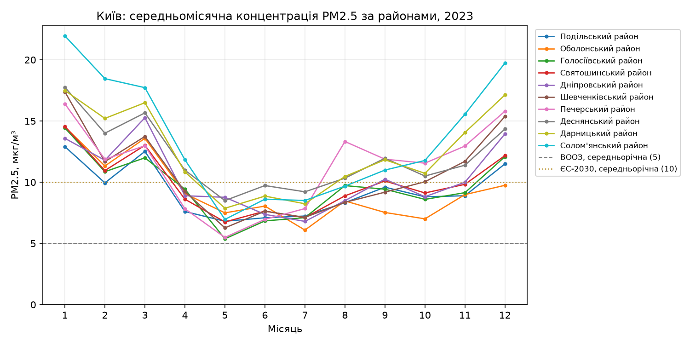
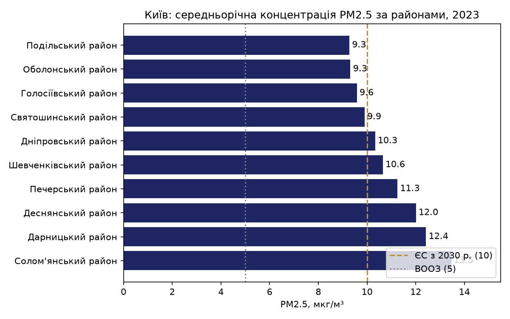
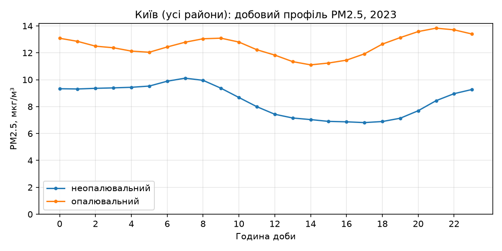
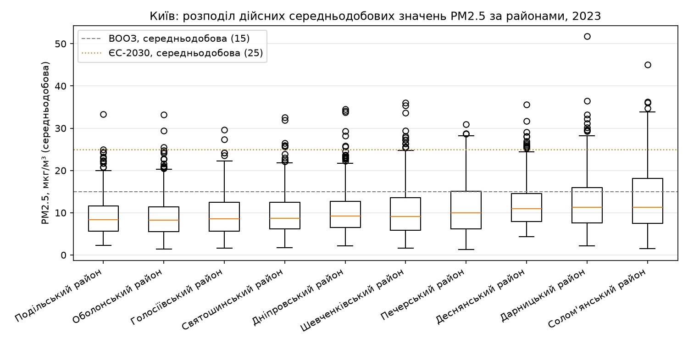
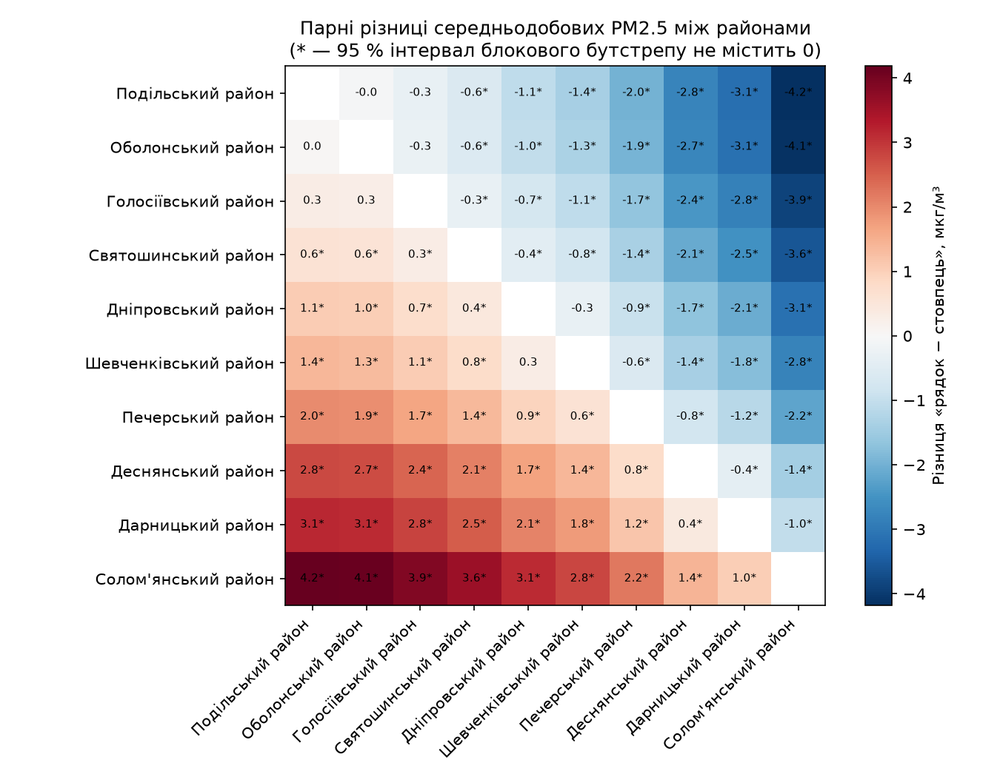

# Практична робота № 4. Відкриті міські дані та індикатори сталості

**Тема:** конвеєр обробки даних про якість повітря засобами Python і pandas  
**Дисципліна:** Інноваційні інформаційні технології  
**Студент:** Демчук Андрій Юрійович, група М КН-2026-1  
**Варіант:** 2 — Київ за районами, 2023 рік

## Як запустити

```powershell
cd pr4
python -m venv .venv
.\.venv\Scripts\Activate.ps1          # macOS/Linux: source .venv/bin/activate
pip install -r requirements.txt
python scripts/download_data.py --years 2023 --districts
jupyter notebook notebooks/pr4_kyiv_pm25.ipynb
```

Перевірка виконання ноутбука «з нуля» без відкриття браузера:

```powershell
jupyter nbconvert --to notebook --execute --inplace notebooks/pr4_kyiv_pm25.ipynb
```

Для відтворення розібраного прикладу Харкова (2021–2023) спершу виконайте
`python scripts/download_data.py` і запустіть `notebooks/pr4_kharkiv_pm25.ipynb`.
Його графіки зберігаються окремо в `reports/figures/kharkiv_example/`, а результати
збіглися з методичними вказівками: 14,9 → 8,3 → 5,8 мкг/м³.

Файли `data/raw/*.csv` не комітяться: їх завантажує `scripts/download_data.py`.

## 1. Варіант і питання дослідження

- **Варіант:** 2, місто Київ (`city_id = 2`, `slug = kyiv`), 10 адміністративних районів
  (`district_id` 95–104), 2023 рік.
- **Питання:** внутрішньоміська нерівність — який район найчистіший і найзабрудненіший
  за середньорічною концентрацією PM2.5? Чи значуща різниця з огляду на повноту даних районів?
- **Гіпотеза H1:** найзабрудненіший район має вищу концентрацію PM2.5, ніж найчистіший,
  і різниця більша за випадкові коливання від доби до доби.
  **H0:** 95 % довірчий інтервал середньої парної різниці містить 0.

## 2. Дані

| Параметр | Значення |
| --- | --- |
| Основний набір | «Щогодинні концентрації та індекс якості атмосферного повітря для дрібнодисперсного пилу фракції 2.5 мікронів в районах населених пунктів України» |
| Посилання | <https://data.gov.ua/dataset/12362dc6-6252-439d-b36e-26d0d085733f> |
| Набір для звірки | Те саме «… в населених пунктах України»: <https://data.gov.ua/dataset/402d427f-f024-465a-97a9-5ed29f510015> |
| Розпорядник | ГО «SaveDnipro» |
| Ліцензія | Creative Commons Attribution (CC BY) |
| Використані файли | `saveecobot_city_districts.csv` (довідник районів, 79 районів), `saveecobot_city_districts_pm25_and_aqi_pm25_2023.csv` (331 409 рядків, з них 87 565 — райони Києва), `saveecobot_aqi_cities.csv`, `saveecobot_cities_pm25_and_aqi_pm25_2023.csv` |
| Період | 01.01.2023–31.12.2023, щогодинні значення |

Райони Києва відібрано за ключем `city_id`, а не за назвою: спершу в довіднику міст
знайдено `city_id = 2` (назва + область + тип і `assert` на один рядок), потім у довіднику
районів — 10 рядків із цим `city_id`.

## 3. Якість даних

### Виявлені проблеми та очищення

| Перевірка | Результат | Пояснення |
| --- | --- | --- |
| Значення `NULL` у `pm25` | 65 (від 1 до 40 на район) | pandas читає `NULL` як `NaN`; рядки видалено, нулями не замінювалися |
| Неможливі значення (< 0 або > 1000) | 0 | Перевірку залишено як захисну |
| Повні дублікати рядків | 0 | На відміну від Харкова 2021–2022 рр., у районних даних 2023 р. дублікатів немає |
| Повтори пари «район + година» | 0 | Повтор години перевіряється в межах району: різні райони в одну годину — не дублікат |
| Позначки не на початку години / поза 2023 р. | 0 / 0 | Ряд регулярний |
| Порядок записів | Не хронологічний у файлі | Відсортовано за районом і часом, час став індексом |

Після очищення: **87 565 → 87 500 рядків**. Найбільше `NULL` має Деснянський район (40),
переважно в січні 2023 р.

### Повнота, % годин

| Район | Січ | Лют | Бер | Квіт–Груд | Рік |
| --- | ---: | ---: | ---: | ---: | ---: |
| Голосіївський | 100,0 | 100,0 | 99,7 | 100,0 | 100,0 |
| Дарницький | 99,9 | 100,0 | 99,7 | 100,0 | 100,0 |
| Деснянський | **94,1** | 98,1 | 99,7 | 100,0 | **99,3** |
| Дніпровський | 100,0 | 100,0 | 99,9 | 100,0 | 100,0 |
| Оболонський | 100,0 | 100,0 | 99,7 | 100,0 | 100,0 |
| Печерський | 98,0 | 100,0 | 99,7 | 100,0 | 99,8 |
| Подільський | 99,9 | 99,1 | 99,7 | 100,0 | 99,9 |
| Святошинський | 99,7 | 100,0 | 99,7 | 100,0 | 100,0 |
| Солом'янський | 100,0 | 100,0 | 99,9 | 100,0 | 100,0 |
| Шевченківський | 100,0 | 100,0 | 99,7 | 100,0 | 100,0 |

Повна таблиця за всіма місяцями — `data/processed/kyiv_pm25_completeness.csv`.

### Пропуски та їх причини

- **26.03.2023 — перехід на літній час.** Запис о 02:00 має `NULL` в усіх 10 районах
  (це єдина година, коли немає даних жодного району), а позначки 03:00 у 8 районах немає,
  бо такої години в місцевому часі не існує. Тому повнота березня становить 99,7–99,9 %.
  Це особливість обліку часу, а не дефект станцій.
- **Січень–лютий 2023 р.** Найдовші пропуски: Деснянський — 6 год (12.01, 11:00),
  4 год (10.01) і 4 год (21.01); Печерський — 4 год (09.01) і 4 год (12.01);
  Подільський — 4 год (07.02). Ці дати припадають на період масованих атак на
  енергосистему й аварійних відключень у Києві взимку 2022–2023 рр. Оскільки пропуски
  локальні (інші райони в ці години працювали), їх ймовірна причина — знеструмлення
  чи зв'язок окремих станцій, а не збій системи збору.
- Пропуски короткі (до 6 год), тому лише одна доба Деснянського району (з 3650 районо-діб)
  недійсна за правилом 18 годин.

Висновок: повнота кожного району ≥ 99,3 % годин і ≥ 99,7 % діб, тож усі річні значення
надійні за правилом ≥ 90 %, а різниця між районами не може пояснюватися різною повнотою.

## 4. Індикатори

Методика — підрозділ 4.4 методичних вказівок: доба дійсна при ≥ 18 вимірах; середньорічна
концентрація — середнє дійсних середньодобових значень (ISO 37120, ЦСР 11.6.2).

| Район | PM2.5, мкг/м³ | Дійсних діб | Повнота, % | Діб > 15 | Діб > 25 | Рівень ВООЗ | × ВООЗ | ЄС: річна ≤ 10 | ЄС: ≤ 18 діб > 25 |
| --- | ---: | ---: | ---: | ---: | ---: | --- | ---: | --- | --- |
| Подільський | **9,3** | 365 | 100,0 | 47 | 1 | IT-4 | 1,9 | так | так |
| Оболонський | 9,3 | 365 | 100,0 | 57 | 3 | IT-4 | 1,9 | так | так |
| Голосіївський | 9,6 | 365 | 100,0 | 59 | 2 | IT-4 | 1,9 | так | так |
| Святошинський | 9,9 | 365 | 100,0 | 51 | 6 | IT-4 | 2,0 | так | так |
| Дніпровський | 10,3 | 365 | 100,0 | 58 | 7 | IT-3 | 2,1 | ні | так |
| Шевченківський | 10,6 | 365 | 100,0 | 74 | 14 | IT-3 | 2,1 | ні | так |
| Печерський | 11,3 | 365 | 100,0 | 93 | 13 | IT-3 | 2,3 | ні | так |
| Деснянський | 12,0 | 364 | 99,7 | 86 | 12 | IT-3 | 2,4 | ні | так |
| Дарницький | 12,4 | 365 | 100,0 | 103 | 21 | IT-3 | 2,5 | ні | ні |
| Солом'янський | **13,5** | 365 | 100,0 | 126 | 38 | IT-3 | 2,7 | ні | ні |

### Порівняння з нормативами

- **Настанова ВООЗ 2021 (5 мкг/м³ за рік, 15 мкг/м³ за добу, 3–4 перевищення):** не виконується
  в жодному районі. Середньорічні значення в 1,9–2,7 раза вищі за настанову, а діб понад
  15 мкг/м³ — від 47 до 126, тобто в 12–30 разів більше за допустимі 3–4.
- **Проміжні цілі ВООЗ:** чотири райони (Подільський, Оболонський, Голосіївський,
  Святошинський) відповідають IT-4, шість — IT-3.
- **ЄС-2030, річна гранична величина 10 мкг/м³:** виконують лише 4 райони; 6 районів її
  перевищують.
- **ЄС-2030, добова величина 25 мкг/м³ (не більше 18 діб на рік):** не виконують Дарницький
  (21 доба) і Солом'янський (38 діб).
- **Звірка з міським рядом Києва** (набір «… в населених пунктах»): 10,7 мкг/м³ за 365 дійсних
  діб, середнє 10 районів — 10,8 мкг/м³. Районні дані узгоджуються з міським індикатором.

### Ручна перевірка формул

- **Подільський район:** повнота за (5) — 365/365 · 100 % = 100 % ≥ 90 %, значення надійне;
  за (8) 5 < 9,3 ≤ 10 — рівень IT-4; за (7) K = 9,28/5 ≈ 1,9; за (6) E(15) = 47,
  E(25) = 1 ≤ 18.
- **Солом'янський район:** повнота 365/365 · 100 % = 100 %; 10 < 13,5 ≤ 15 — IT-3;
  K = 13,46/5 ≈ 2,7; E(15) = 126, E(25) = 38 > 18 — добова вимога ЄС-2030 не виконується.
- **Деснянський район:** повнота 364/365 · 100 % ≈ 99,7 % — єдиний район із недійсною добою.

## 5. Графіки



*Рис. 1. Середньомісячна концентрація PM2.5 за районами Києва, 2023.* Середнє по районах
зменшується з 16,1 мкг/м³ у січні до 7,0 у травні й зростає до 14,2 у грудні.
Солом'янський район найбрудніший у січні–березні та листопаді–грудні; влітку відмінності
між районами значно менші.



*Рис. 2. Середньорічна концентрація PM2.5 за районами порівняно з нормативами ЄС-2030 і ВООЗ.*



*Рис. 3. Добовий профіль PM2.5 за всіма районами.* В опалювальний період (жовтень–квітень)
середня концентрація — 12,5 мкг/м³ проти 8,5 у неопалювальний, тобто приблизно в 1,5 раза
вища. Максимум припадає на вечір (13,8 мкг/м³ о 21:00 в опалювальний період), мінімум —
на день (≈ 6,8–7,0 мкг/м³ о 14:00–18:00 у теплий період).

## 6. Творча частина: внутрішньоміська нерівність

**Гіпотеза.** Різниця між найзабрудненішим і найчистішим районом значуща, а не випадкова.

**Метод.**

1. Ранжування районів за середньорічною концентрацією й перерахунок на **спільних дійсних
   добах** (364 доби, дійсні в усіх районах одночасно), щоб виключити вплив повноти.
2. **Парне порівняння:** різниця середньодобових значень двох районів в ті самі доби. Погода
   для міста спільна, тому парна різниця не залежить від погодних коливань.
3. **Блоковий бутстреп за тижнями** (10 000 повторів, `seed = 42`) для 95 % довірчого
   інтервалу середньої різниці. Цілі тижні беруться тому, що сусідні доби залежні.
4. Частка діб, коли район був найчистішим чи найбруднішим, і матриця парних різниць усіх
   45 пар районів (2000 повторів бутстрепу для кожної пари).

**Результат.**

| Показник | Значення |
| --- | --- |
| Найчистіший район | Подільський — 9,28 мкг/м³ (Оболонський — 9,32) |
| Найзабрудненіший район | Солом'янський — 13,46 мкг/м³ |
| Розмах | 4,2 мкг/м³ — на 45 % вище за рівень Подільського |
| Ранги на спільних добах | Не змінилися для жодного району; середні змінилися не більше ніж на 0,03 мкг/м³ |
| Парна різниця Солом'янський − Подільський | 4,18 мкг/м³, 95 % ДІ [3,23; 5,17] |
| Діб, коли Солом'янський брудніший за Подільський | 91 % |
| Значущих пар районів | 41 з 45 |

Солом'янський район був найбруднішим у 37,9 % спільних діб; наступні — Деснянський (20,6 %),
Печерський (16,2 %) і Дарницький (15,9 %). Найчистішим найчастіше був Оболонський (39,0 %),
далі Подільський (21,2 %) і Голосіївський (19,0 %).

Незначущими виявилися 4 пари: Подільський–Оболонський (0,04 мкг/м³),
Голосіївський–Подільський (0,31), Голосіївський–Оболонський (0,27)
і Дніпровський–Шевченківський (0,32). Отже, однозначно назвати **найчистіший** район не можна:
Подільський, Оболонський і Голосіївський статистично не відрізняються й утворюють групу
найчистіших. **Найзабрудненіший** район визначається однозначно: Солом'янський значуще
брудніший за кожен інший район.



*Рис. 4 (власний). Розподіл дійсних середньодобових значень PM2.5 за районами.*



*Рис. 5 (власний). Матриця парних різниць районів; «*» — 95 % інтервал не містить 0.*

**Відповідь на питання варіанта.** H1 підтверджено: різниця між Солом'янським (13,5 мкг/м³)
і Подільським (9,3 мкг/м³) районами значуща — 95 % ДІ [3,2; 5,2] мкг/м³ не містить нуля.
Повнота даних на висновок не впливає: вона становить ≥ 99,3 % годин у кожному районі,
а перерахунок на спільних добах не змінив жодного рангу. Відмінність найбільша в
опалювальний період: у січні Солом'янський мав 22,0 мкг/м³ проти 12,9 у Подільському.

**Яких даних бракує:** кількість і розташування сенсорів у кожному районі (значення району —
середнє його станцій), відстань станцій до магістралей і промислових об'єктів, метеодані
(вітер, вологість), дані про джерела опалення й транспортні потоки.

### Додатково (крок 14): чутливість до порогу дійсної доби

| Район | 12 год | 18 год | 22 год | Дійсних діб: 12 / 18 / 22 |
| --- | ---: | ---: | ---: | --- |
| Деснянський | 12,03 | 12,01 | 11,86 | 365 / 364 / 358 |
| Печерський | 11,25 | 11,25 | 11,23 | 365 / 365 / 363 |
| Подільський | 9,28 | 9,28 | 9,27 | 365 / 365 / 364 |
| Інші 7 районів | без змін | без змін | без змін | 365 / 365 / 365 |

За повних даних поріг майже не впливає на індикатор: найбільша зміна — у Деснянському районі,
де найбільше пропусків, −0,15 мкг/м³ при порозі 22 год. Ранжування районів не змінюється.

## 7. Висновки й обмеження

1. **Рівень забруднення.** Середньорічна концентрація PM2.5 у районах Києва 2023 р. становила
   9,3–13,5 мкг/м³ (міський ряд — 10,7 мкг/м³). Настанова ВООЗ (5 мкг/м³) не виконується в жодному
   районі (перевищення в 1,9–2,7 раза), граничну величину ЄС-2030 (10 мкг/м³) виконують лише
   4 райони з 10.
2. **Нерівність.** Найзабрудненіший — Солом'янський район: 13,5 мкг/м³, 126 діб понад 15 і 38 діб
   понад 25 мкг/м³. Найчистішу групу утворюють Подільський, Оболонський і Голосіївський
   (9,3–9,6 мкг/м³), між якими різниця незначуща. Різниця Солом'янського й Подільського —
   4,2 мкг/м³, 95 % ДІ [3,2; 5,2], значуща.
3. **Сезонність.** В опалювальний період концентрації в середньому в 1,5 раза вищі
   (12,5 проти 8,5 мкг/м³), максимум — у січні (16,1 мкг/м³ у середньому по районах) і ввечері
   (близько 21:00). Більшість діб понад 25 мкг/м³ припадає на січень–березень і грудень.
4. **Якість даних.** Повнота ≥ 99,3 % годин у кожному районі, недійсна лише 1 доба
   Деснянського району. Дублікатів немає, 65 значень `NULL` видалено. Спільна для всіх районів
   прогалина — лише година переходу на літній час 26.03.2023.
5. **Обмеження.** Дані отримано від недорогих сенсорів громадянського моніторингу, а не від
   референтних станцій; можливе завищення при високій вологості. Кількість і розташування
   сенсорів у районах невідомі: значення району може визначатися однією станцією біля
   магістралі. Тому різниця районів відображає різницю мережі сенсорів не менше, ніж різницю
   повітря. Час записано в місцевому часі з переходами на літній час. Аналіз охоплює лише
   2023 р., тому стійкість ранжування в інші роки не перевірено.

## 8. Журнал використання ШІ

Використовувався ШІ-асистент Claude (Anthropic) для адаптації ноутбука прикладу до районів.
Код ноутбука перевірено, розібрано по комірках і виконано на реальних даних.

| Крок | Запит (суть) | Що згенеровано | Що виправлено або перевірено і чому |
| --- | --- | --- | --- |
| Аналіз завдання | Вивчити методичні вказівки, презентацію, шаблон і скласти план роботи | План кроків, команди PowerShell, перелік скріншотів | Спершу відтворено приклад Харкова; результати (26 172 → 26 121 рядків, 14,9 / 8,3 / 5,8 мкг/м³) збіглися з методичкою |
| Крок 4 | Відбір районів Києва | Пошук міста за назвою, областю і типом з `assert`; відбір районів за `city_id`, перевірка унікальності назв | Перевірено, що знайдено рівно 10 районів з `district_id` 95–104, як у презентації |
| Кроки 5–6 | Читання й очищення даних районів | `usecols`/`dtype`, перевірки `NULL`, неможливих значень, дублікатів за районами | Повтор години визначається як повтор пари «район + година», а не лише часу; `NULL` не замінюються нулями |
| Крок 7 | Повнота за районами | Широка таблиця «година × район» з `reindex` на всі 8760 годин року | Варіант із `groupby` + `resample` відкинуто: він рахує повноту від першого запису району, а не від 1 січня, і не бачить пропусків на початку року |
| Кроки 8–9 | Добові значення та індикатори | Правило 18 годин, `groupby("район")` з тією самою агрегацією, що й у прикладі | Звірено нормативи ВООЗ 2021 (5 і 15 мкг/м³), а не 2005 р.; частоти `"h"`, `"D"`, `"MS"` сумісні з pandas 3; виконано ручну перевірку формул (розділ 4) |
| Кроки 8, 10 | Сумісність версій | Перетворення таблиць через `melt`, підписи `boxplot` через `set_xticks` | Уникнуто `stack()` і параметра `labels=` у `boxplot`, які застаріли в pandas 3 і matplotlib 3.10+ |
| Творча частина | Перевірка значущості різниці районів | Парне порівняння діб, блоковий бутстреп за тижнями, матриця пар | Обрано ресемплінг тижнів, а не діб: сусідні доби залежні через погоду, і звичайний бутстреп звузив би інтервал |
| Налаштування репозиторію | Виключити `pr4/` з контексту Docker-збірки | Команда `Add-Content .dockerignore "pr4/"` | Файл не закінчувався переносом рядка, і утворився рядок `.idea/pr4/`; виправлено вручну на два окремі рядки `pr4/` і `.idea/` |

Перед виконанням на реальних даних код перевірено на синтетичних даних тієї ж структури,
зокрема з `NULL`, дублікатами, пропусками й переходом на літній час.
