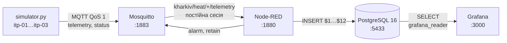
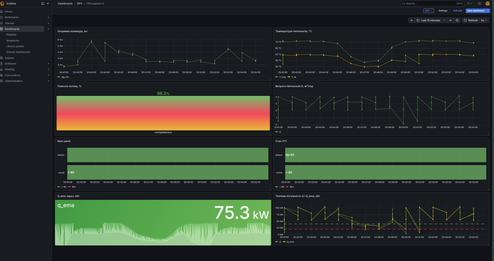

# ПР5. IoT-конвеєр міської інфраструктури

**Студент:** Демчук Андрій Юрійович, група М КН-2026-1  
**Варіант:** № 2 — індивідуальні теплові пункти (ІТП) будинків  
**Дата:** 08.11.2026

Конвеєр «пристрій → MQTT → Node-RED → PostgreSQL → Grafana» у Docker Compose.
Три ІТП щоп'ять секунд публікують температури теплоносія і витрату; конвеєр перевіряє
виміри, обчислює теплову потужність, згладжує її, вмикає тривогу з гістерезисом,
визначає причину тривоги та записує все в базу, а дашборд показує стан мережі.

## Як запустити

```powershell
cd pr5
copy .env.example .env          # паролі — лише локально, .env не комітиться
docker compose up -d            # mosquitto, postgres, nodered, grafana
python -m venv .venv
.\.venv\Scripts\Activate.ps1
pip install -r simulator/requirements.txt
python simulator/simulator.py
```

Node-RED: http://localhost:1880 → ≡ → Import → `nodered/flows_pr5.json` → Deploy.
Grafana: http://localhost:3000 — дашборд «ПР5 варіант 2» завантажується автоматично
з `grafana/dashboards/pr5.json`.

## 1. Архітектура



| Сервіс | Образ | Порт | Призначення |
|---|---|---|---|
| mosquitto | eclipse-mosquitto:2.0.22 | 1883 | MQTT-брокер, постійні сесії й retained-повідомлення |
| postgres | postgres:16 | 5433 → 5432 | база даних `city`, таблиці `heat` і `station_status` |
| nodered | pr5-nodered:4.1 (з `nodered/Dockerfile`) | 1880 | перевірка, обчислення Q, тривоги, запис у базу |
| grafana | grafana/grafana:12.4 | 3000 | дашборд на SQL-запитах |

Усередині мережі Docker сервіси звертаються один до одного за іменами (`mosquitto:1883`,
`postgres:5432`), а симулятор поза Docker — через опубліковані порти (`localhost:1883`).
Grafana читає базу окремим користувачем `grafana_reader` лише з правом `SELECT`.

## 2. Модель даних

### Теми MQTT

| Тема | Хто публікує | Вміст | QoS / retain |
|---|---|---|---|
| `kharkiv/heat/<id>/telemetry` | ІТП кожні 5 с | JSON: `ts`, `t_sup`, `t_ret`, `g`, `t_out` | 1 / ні |
| `kharkiv/heat/<id>/status` | ІТП при підключенні; брокер — як Last Will | `online` / `offline` | 1 / так |
| `kharkiv/heat/<id>/alarm` | Node-RED при зміні стану або причини тривоги | JSON: `ts`, `alarm`, `cause`, `q_ema`, `g_ema` | 1 / так |

Приклад повідомлення телеметрії (насос itp-02 зупинено):

```json
{"ts": 1794162057355, "t_sup": 70.4, "t_ret": 35.0, "g": 0.05, "t_out": -2.5}
```

`t_sup` і `t_ret` — температури подавального й зворотного трубопроводів T_под і T_зв, °C;
`g` — витрата теплоносія G, м³/год; `t_out` — температура зовнішнього повітря з датчика
погодного регулятора ІТП, °C; `ts` — час виміру в мілісекундах Unix, який ставить пристрій.

### Таблиці PostgreSQL (`postgres/init/01_schema.sql`)

| Стовпець | Тип | Обмеження | Зміст |
|---|---|---|---|
| `ts` | timestamptz | NOT NULL, ключ | час виміру |
| `station` | text | NOT NULL, ключ | ідентифікатор ІТП |
| `t_sup` | real | 30…110 | T_под, °C |
| `t_ret` | real | 20…80 | T_зв, °C |
| `g` | real | 0…50 | витрата G, м³/год |
| `t_out` | real | −40…50 | зовнішнє повітря, °C |
| `q`, `q_ema` | real | `q ≥ 0` | теплова потужність і згладжена, кВт |
| `g_ema` | real | NOT NULL | згладжена витрата, м³/год |
| `alarm` | smallint | 0 або 1 | стан тривоги |
| `cause` | smallint | 0, 1 або 2 | 0 — норма, 1 — зупинка насоса, 2 — низьке теплоспоживання |
| `lag_ms` | integer | NOT NULL | затримка конвеєра, мс |

- **`PRIMARY KEY (station, ts)`** — у ІТП не може бути двох вимірів в один момент. Разом із
  `ON CONFLICT (station, ts) DO NOTHING` це робить запис ідемпотентним: повторна доставка
  повідомлення при QoS 1 не створює дубліката.
- **`CHECK`** на діапазони збігаються з перевіркою в Node-RED — друга лінія захисту:
  база відхилить неможливе значення, навіть якщо перевірка в потоці пропустить помилку.
- **`CHECK (t_ret <= t_sup)`** — обмеження узгодженості: у системі опалення зворотна вода
  не може бути гарячішою за подавальну.
- **Індекс `heat_ts_idx (ts)`** — дашборд завжди відбирає рядки за діапазоном часу;
  пошук за станцією забезпечує первинний ключ.
- Таблиця **`station_status`** зберігає лише зміни стану online/offline; час ставить база
  (`DEFAULT now()`).
- Формат «один рядок — один вимір»: новий ІТП — це нові рядки, а не нові стовпці.

### Навантаження на мережу (формули 1, 2)

Розмір пакета MQTT PUBLISH з QoS 1: тема 29 байтів, JSON ≈ 78 байтів і службові поля —
разом b ≈ 111 байтів.

- M = n · 3600 / Δt = 3 · 3600 / 5 = **2160 повідомлень на годину**.
- V = n · 86 400 / Δt · b = 3 · 17 280 · 111 ≈ **5,8 МБ на добу**, або ≈ 0,24 МБ на годину.
- Для 1000 ІТП: V ≈ 1000 · 17 280 · 111 ≈ **1,9 ГБ на добу**. Якщо збільшити Δt до 60 с,
  обсяг зменшиться в 12 разів (≈ 160 МБ на добу), але аварія насоса виявлятиметься на
  хвилини пізніше. Це компроміс між детальністю, трафіком і енергоспоживанням (GreenOps, Лекція 6).

## 3. Обробка потоку

### Симулятор (`simulator/simulator.py`)

| ІТП | Будинок | G_ном, м³/год | Q_ном при −3 °C, кВт |
|---|---|---|---|
| itp-01 | 5-поверховий | 2,2 | ≈ 56 |
| itp-02 | 9-поверховий | 3,2 | ≈ 82 |
| itp-03 | 16-поверховий | 4,0 | ≈ 102 |

- **Погода.** Добовий хід зовнішньої температури — аналог формули (3):
  t_out(h) = −3 + 3·cos(2π(h − 15)/24), максимум о 15:00.
- **Температурний графік.** Відносне навантаження f = (20 − t_out) / (20 − (−3)): дорівнює 1 при
  −3 °C і 0 при +20 °C. Тоді T_под = 20 + 52·f і ΔT = T_под − T_зв = 22·f; при −3 °C це 72/50 °C.
  Так працює погодне регулювання ІТП: що тепліше надворі, то нижчі T_под і перепад ΔT.
  Будинок реагує на зміну погоди з інерцією τ = 30 с (сценарій прискорений).
- **AR(1)** за формулою (4) з φ = 0,8 для відхилень T_под (σ = 0,4 °C) і G (σ = 2 % від G_ном).
- **Збої сенсора** з імовірністю 2 %: `-127` °C у T_под або T_зв (код обриву цифрового
  термодатчика) чи `-1` у G (помилка витратоміра).
- **Last Will** `offline` із retain, keep-alive k = 10 с.

Параметри підібрано так, щоб порядок величин відповідав опаленню житлових будинків: перепад
температур 20–25 °C у розрахунковому режимі, витрата, за якою з формули (В2) виходить потужність
50–100 кВт. Значення умовні й не взяті з реального ІТП.

Сценарій повторюється кожні 10 хв:

| Час циклу | Подія | Що відбувається з даними |
|---|---|---|
| 0:30–4:30 | Відлига: t_out → +13 °C у всій мережі | T_под ≈ 36 °C, ΔT ≈ 7 °C, G без змін; Q itp-01 ≈ 17 кВт |
| 5:00–7:00 | Зупинка циркуляційного насоса itp-02 | G → 0,05 м³/год за ~10 с, T_зв остигає до 25 °C, T_под без змін |
| 7:30–9:30 | Знеструмлення контролера itp-03 | Повідомлення не надходять, брокер публікує Last Will |

### Перевірка даних — аналог формули (5)

v_t = 1 ⇔ 30 ≤ T_под ≤ 110 ∧ 20 ≤ T_зв ≤ 80 ∧ 0 ≤ G ≤ 50 ∧ −40 ≤ t_out ≤ 50 ∧ T_зв ≤ T_под.

Перевірка `typeof v === "number"` відкидає рядки й відсутні поля. Відхилені виміри йдуть на
другий вихід вузла «Перевірка даних» (наприклад, `errors: ["t_sup"]`, `t_sup: -127`).

### Показник варіанта — формула (В2)

Q = 1,163 · G · (T_под − T_зв), кВт,

де 1,163 кВт·год/(м³·К) — теплоємність одиниці об'єму води.

### Згладжування і тривога з гістерезисом — формули (8), (9')

s_t = α·Q_t + (1 − α)·s_{t−1}, α = 0,2. Тим самим способом згладжується витрата G.

Тривога вмикається на **падіння** потужності: A_t = 1, якщо A_{t−1} = 0 і s_t ≤ θ_on = 20 кВт;
A_t = 0, якщо A_{t−1} = 1 і s_t ≥ θ_off = 40 кВт; інакше стан не змінюється.

- **Чому такі пороги.** Номінальна потужність ІТП становить 50–100 кВт, тож 20 кВт означає
  втрату понад 60 % тепла будинку. Поріг 40 кВт вимагає повернення до рівня, близького до
  номінального малого будинку. Широкий зазор у 20 кВт значно більший за шум Q_ema (1–2 кВт).
- **Якщо пороги зблизити,** наприклад до 20/22 кВт, згладжене значення біля межі коливалося б
  через обидва пороги, і тривога «блимала б». Слабке місце обраних порогів — малий будинок
  itp-01: у найтеплішу пору доби його номінальна Q ≈ 42–45 кВт, лише трохи вище θ_off, тому
  після епізоду тривога може вимкнутися із запізненням.

### Причина тривоги — правило двох величин (творча частина)

Під час тривоги причина визначається поточною витратою:
**cause = 1 (зупинка насоса), якщо G < 0,5 м³/год**, інакше **cause = 2 (низьке теплоспоживання)**.
Причина 1 «прилипає» до кінця епізоду. Тривога й причина публікуються в
`kharkiv/heat/<id>/alarm` із retain.

### Ручна перевірка на трьох вимірах (20:31:08)

| ІТП | T_под | T_зв | G | Q вручну, кВт | Q у базі | Q_ema вручну | Q_ema у базі |
|---|---|---|---|---|---|---|---|
| itp-01 | 71,9 | 50,4 | 2,15 | 1,163 · 2,15 · 21,5 = 53,8 | 53,8 | 0,2 · 53,8 + 0,8 · 56,1 = 55,6 | 55,6 |
| itp-02 | 71,5 | 34,1 | 0,05 | 1,163 · 0,05 · 37,4 = 2,2 | 2,2 | 0,2 · 2,2 + 0,8 · 6,3 = 5,5 | 5,5 |
| itp-03 | 71,2 | 49,7 | 4,19 | 1,163 · 4,19 · 21,5 = 104,8 | 104,8 | — | 104,2 |

У цей момент насос itp-02 стоїть: G = 0,05 м³/год, Q_ema = 5,5 кВт ≤ 20, тому `alarm = 1`,
`cause = 1`. ІТП itp-01 і itp-03 працюють у нормі (`alarm = 0`).

### Запис у базу

Вузол «Параметри запиту» формує масив `msg.params` з 12 значень, а запит використовує
параметри `$1…$12` — значення передаються окремо від тексту SQL, тому SQL-ін'єкція неможлива.
Затримка конвеєра L = t_зап − t_вим (формула 10) — 12-й параметр.

```sql
INSERT INTO heat (ts, station, t_sup, t_ret, g, t_out,
                  q, q_ema, g_ema, alarm, cause, lag_ms)
VALUES (to_timestamp($1 / 1000.0), $2, $3, $4, $5, $6,
        $7, $8, $9, $10, $11, $12)
ON CONFLICT (station, ts) DO NOTHING;
```

## 4. Дашборд



Файл дашборду: `grafana/dashboards/pr5.json` (8 панелей). Діапазон — останні 15 хв, оновлення — 5 с.
Усі запити мають формат **Time series**: текстовий стовпець `station` розділяє дані на окремі ряди.

| Панель | Тип | Запит (скорочено) |
|---|---|---|
| Температури теплоносія, °C | Time series | `$__timeGroupAlias(ts, $__interval), station, avg(t_sup) AS "T_под", avg(t_ret) AS "T_зв"` |
| Витрата теплоносія G, м³/год | Time series | `$__timeGroupAlias(...), station, avg(g) AS "G"` |
| Теплова потужність Q і Q_ema, кВт | Time series, пороги 20/40 лініями | `$__timeGroupAlias(...), station, avg(q) AS "Q", avg(q_ema) AS "Q_ema"` |
| Q_ema зараз, кВт | Stat, Last * | `ts AS "time", station, q_ema` |
| Стан ІТП | State timeline, 1 → online, 0 → offline | стан на початок діапазону (`DISTINCT ON`) `UNION ALL` зміни всередині |
| Тривоги і причина | State timeline, 0/1/2 | `ts AS "time", station, cause` |
| Повнота потоку, % | Bar gauge | `100.0 * count(*) * 5 / ($__unixEpochTo() - $__unixEpochFrom())` — формула (11) |
| Затримка конвеєра, мс | Time series | `$__timeGroupAlias(...), station, avg(lag_ms)` |

Усі запити містять `WHERE $__timeFilter(ts)` і `ORDER BY 1`; повні тексти — у `pr5.json`.

**Результати першого запуску (≈ 14 хв, psql):**

| ІТП | Рядків | Середня Q, кВт | Мін. Q_ema, кВт | Рядків із тривогою | з них cause = 1 | з них cause = 2 |
|---|---:|---:|---:|---:|---:|---:|
| itp-01 | 167 | 41,0 | 17,7 | 37 | 0 | 37 |
| itp-02 | 167 | 49,9 | 2,9 | 18 | 18 | 0 |
| itp-03 | 143 | 71,2 | 33,9 | 0 | 0 | 0 |

ІТП itp-03 має на 24 рядки менше через двохвилинне знеструмлення (24 виміри по 5 с).
Під час відлиги Q_ema itp-03 знизилася лише до 33,9 кВт, тому тривоги не було.

## 5. Експеримент зі стійкістю

| Сценарій | Що зробили | Що побачили | Чи втрачено дані | Патерн (Лекція 5) |
|---|---|---|---|---|
| А. Знеструмлення ІТП | Вбудовано в сценарій: itp-03 замовкає на 2 хв без DISCONNECT | `offline` з'являється через 15–16 с після знеструмлення (20:32:18 → 20:32:33, 20:42:18 → 20:42:34, 20:52:18 → 20:52:34); за формулою (12) 1,5 · 10 = 15 с | Так, 2 хв: пристрій не вимірював | Last Will, плавна деградація: стан `offline` замість «немає даних» |
| Б. Зупинка Node-RED на 60 с | `docker compose stop nodered` → `start` | Розривів немає, максимальна затримка 70 653 мс, далі повернулася до 2–6 мс | Ні — брокер зберіг повідомлення в постійній сесії (QoS 1, `clean session` вимкнено) | «Зберегти–переслати» на рівні брокера |
| В. Зупинка PostgreSQL на 60 с | `docker compose stop postgres` → `start` | Вузол «PostgreSQL: виміри» в стані Error (черга 36), у «Помилки запису» — `getaddrinfo ENOTFOUND postgres` і `EAI_AGAIN`; запит розривів показав 70 с для itp-01 і 65 с для itp-02 (21:04, на час зупинки й запуску бази) | Так — Node-RED не зберігає повідомлення, які не вдалося записати | Потрібен буфер «зберегти–переслати» в Node-RED |
| В + буфер (крок 13) | Той самий експеримент з буфером | Під час простою «у буфері: 29», після запуску бази — «надіслано 30, лишилось 0», черга запису 0 | Ні — після 21:07 розривів немає, крім запланованих знеструмлень itp-03; усі виміри дописано, повтор безпечний завдяки `ON CONFLICT` | «Зберегти–переслати» в обробнику потоку |

Розрив 20 с о 21:06:53 в усіх ІТП припав на момент Deploy імпортованого потоку з буфером, коли Node-RED перезапускав вузли MQTT; він не пов'язаний з експериментами.

**Як усунути втрату даних в експерименті В.** Реалізовано в додатковому кроці 13: вузол
`catch` перехоплює помилку запису виміру й кладе його параметри в чергу контексту потоку,
а вузол `inject` кожні 10 с надсилає до 100 вимірів із черги повторно. Якщо база ще недоступна,
вони знову потрапляють у буфер. Під час досилання затримка `lag_ms` перераховується, тож
на панелі затримки видно, скільки вимір чекав у буфері. Буфер обмежено 50 000 вимірів.
За формулами (1) і (2) година простою бази — це 2160 вимірів, ≈ 0,24 МБ у форматі MQTT
або ≈ 0,4 МБ у пам'яті Node-RED, тож ліміту вистачає більш ніж на 20 год.
Обмеження: черга живе в оперативній пам'яті й зникне під час перезапуску Node-RED.
Для промислової системи її варто зберігати на диску (`contextStorage: localfilesystem`)
або в окремій черзі повідомлень.

## 6. Творче питання: аварія насоса чи тепла погода?

**Питання.** Як за даними відрізнити аварію циркуляційного насоса від зниження теплоспоживання
в теплу погоду?

**Відповідь.** За однією потужністю Q це неможливо: в обох випадках вона падає нижче 20 кВт.
У цьому запуску Q_ema у момент спрацювання тривоги становила 19,8 кВт у відлигу (itp-01) і
18,5 кВт під час аварії насоса (itp-02). Правило використовує другу величину — витрату G:

| Ознака | Аварія насоса (itp-02) | Тепла погода (itp-01) |
|---|---|---|
| Q_ema під час тривоги | 18,5 кВт | 19,8 кВт |
| G | **0,05 м³/год** (у 40 разів нижче номіналу) | **2,11–2,15 м³/год** (близько номіналу 2,2) |
| T_под | без змін, ≈ 71 °C | знижена регулятором до ≈ 36 °C |
| T_зв і ΔT | T_зв остигає до ≈ 34 °C, ΔT зростає до ≈ 37 °C | ΔT зменшується до ≈ 7 °C |
| Швидкість зміни | G падає за 10–15 с | Q знижується поступово разом із погодою |
| Рішення правила | **cause = 1** | **cause = 2** |

Правило «Q_ema ≤ 20 кВт і G < 0,5 м³/год → аварія насоса; Q_ema ≤ 20 кВт і G у нормі →
низьке теплоспоживання» в цьому запуску класифікувало всі 55 рядків із тривогою правильно:
18 — як зупинку насоса, 37 — як низьке теплоспоживання. Тривогу з `cause = 2` диспетчер може
вважати інформаційною, а з `cause = 1` — аварійною: без циркуляції будинок вистигає, а взимку
система може замерзнути. Додатково правило можна підтвердити зовнішньою температурою t_out
(у відлигу +13 °C) і тим, що за теплої погоди Q знижується в усіх ІТП одночасно, а аварія
насоса — лише в одному.

Межа G < 0,5 м³/год становить 12–23 % номінальної витрати будинків мережі; для реальних ІТП
її варто задавати відносно номіналу кожного пункту.

## 7. Висновки й обмеження

1. **Конвеєр.** Розгорнуто чотири контейнери однією командою `docker compose up -d`.
   Конвеєр обробляє 2160 повідомлень на годину від трьох ІТП (формула 1, ≈ 5,8 МБ на добу)
   із типовою затримкою 2–6 мс від виміру до запису.
2. **Якість даних.** Перевірка за аналогом формули (5) відкидає збої сенсорів (`-127` °C,
   `-1` м³/год), а обмеження `CHECK` у базі дублюють її. Повнота потоку itp-03 нижча через
   двохвилинне знеструмлення в кожному 10-хвилинному циклі: 143 рядки проти 167 в інших ІТП.
3. **Виявлення подій.** Аварію насоса itp-02 виявлено через ≈ 40 с після зупинки (Q_ema = 18,5 кВт),
   тривога вмикалася й вимикалася по одному разу на епізод завдяки гістерезису 20/40 кВт.
   Відлига викликала тривогу лише в найменшому будинку itp-01 (Q_ema 17,7 кВт), а itp-02 й itp-03
   лишилися між порогами.
4. **Причина тривоги.** Правило двох величин (Q і G) правильно розрізнило всі 55 рядків
   тривоги: 18 — зупинка насоса, 37 — низьке теплоспоживання.
5. **Стійкість.** Відмову пристрою виявлено через 15–16 с (Last Will, 1,5 · k). Зупинка Node-RED
   на 60 с не призвела до втрат (постійна сесія MQTT, ідемпотентний запис, затримка до 70,7 с).
   Зупинка PostgreSQL без буфера призвела до втрати даних, а з буфером «зберегти–переслати» —
   ні.
6. **Обмеження.** Дані згенеровано симулятором зі спрощеною фізикою та прискореним сценарієм
   (відлига за хвилину). Пороги варіанта однакові для будинків різної потужності, тож для малого
   будинку θ_off близький до номіналу. Брокер працює без автентифікації й TLS, а Node-RED і
   PostgreSQL — в одному екземплярі без резервування. Буфер Node-RED зберігається в пам'яті.
   Годинники симулятора й Node-RED збігаються, бо працюють на одному комп'ютері; у реальній
   мережі потрібна синхронізація NTP.

## 8. Використання ШІ

Інструмент: Claude (Anthropic). Спершу приклад PM2.5 відтворено вручну за методичними
вказівками; ШІ використовувався для адаптації до варіанта 2.

| Крок | Запит (суть) | Що згенеровано | Що перевірено й виправлено |
|---|---|---|---|
| План роботи | Вивчити методичні вказівки й шаблон, скласти порядок виконання | Кроки, команди, перелік скріншотів | — |
| Симулятор | Адаптувати клас Station під ІТП: T_под, T_зв, G, подія — зупинка насоса | Модель погоди й температурного графіка, AR(1), сценарій, коди збоїв | Перевірено paho-mqtt 2.x (`CallbackAPIVersion.VERSION2`, `on_connect` з п'ятьма параметрами). Тестовий прогін показав, що у відлигу тривога вмикалася в усіх трьох ІТП: T_под падала одразу, а T_зв запізнювалася, і ΔT короткочасно провалювалася. Додано спільну інерцію будинку для обох температур |
| Node-RED | Переписати перевірку, обчислення Q, тривогу й параметри запиту | Код вузлів function, запит INSERT на 12 параметрів | У першій версії причину визначала згладжена G, і причина «стрибала» 2 → 1 → 2 під час аварії насоса. Тепер причину визначає поточний вимір G, і причина 1 «прилипає» до кінця епізоду. Ручну перевірку Q та Q_ema наведено в розділі 3 |
| Схема БД | Таблиця для варіанта з ключем і обмеженнями | `01_schema.sql` | Перевірено, що `grafana_reader` не може виконати INSERT, а `CHECK (t_ret <= t_sup)` відхиляє неможливий рядок |
| Дашборд | SQL-запити 8 панелей | Тексти запитів і налаштування | Запити перевірено в psql з підставленими вручну макросами. Під час збирання дашборду в Grafana в усіх панелях лишився формат Table, через що ІТП зливалися в одну лінію; формат виправлено на Time series в експортованому JSON |
| Крок 13 | Буфер «зберегти–переслати» | Вузли catch, inject і два function | Затримку для дописаних з буфера вимірів перераховано, щоб вона показувала реальний час очікування. Перевірено повторним експериментом В |
| Налаштування | Виключити pr5 з контексту Docker-збірки ПЗ 2 | Рядок `pr5/` у `.dockerignore` | Додано з переносом рядка, щоб не повторити склеювання рядків із ПЗ 4 |
