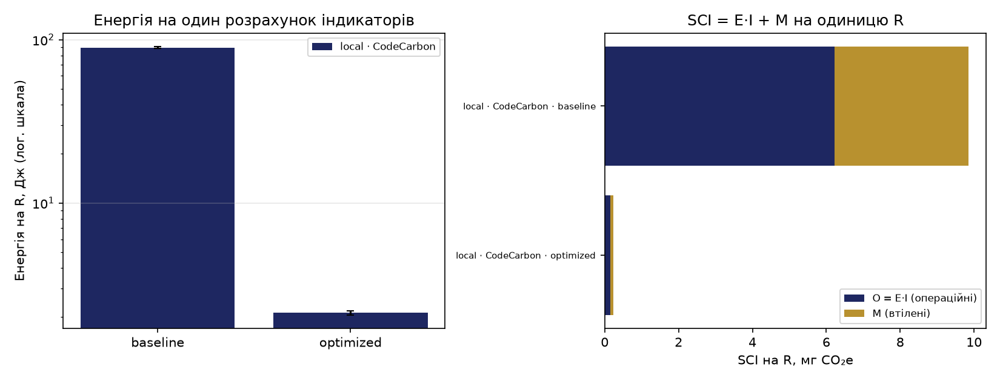

# ПР6. Вимірювання вуглецевої інтенсивності ПЗ

**Студент:** Демчук Андрій Юрійович, група М КН-2026-1  
**Варіант:** № 2 — мінімальні типи даних (category, float32)  
**Дата:** 09.11.2026

## Як відтворити

```powershell
cd pr6
python -m venv .venv
.\.venv\Scripts\Activate.ps1
pip install -r requirements.txt
python measure.py check            # чим вимірює CodeCarbon
python measure.py verify           # усі версії дають той самий результат
python -m bench.variant            # пам'ять таблиці: optimized проти variant
python measure.py idle
python measure.py run baseline
python measure.py run optimized
python measure.py run variant
python analyze.py                  # енергія на R, SCI, рисунок
```

У GitHub Actions той самий код виконує `.github/workflows/pr6-energy.yml`; результати
CI взято з артефакту `pr6-results` запуску на коміті варіанта.

## 1. Об'єкт і функціональна одиниця

Навантаження — розрахунок індикаторів якості повітря з ПР4 для Києва (`city_id = 2`) і
Харкова (`city_id = 219`) за 2021–2023 рр.: середньорічна концентрація PM2.5 з правилом
18 годин, доби з перевищенням 15 і 25 мкг/м³, повнота і рівень ВООЗ.

**Функціональна одиниця R** — один повний розрахунок таблиці індикаторів (2 міста × 3 роки).
Усі енергії й викиди нижче наведено на одну R.

| Версія | Що робить |
|---|---|
| `baseline` | Читає кожен файл окремо для кожного міста, розбирає дати й перевіряє діапазон рядок за рядком, рахує добові середні циклом по днях |
| `optimized` | Кожен файл читається один раз (3 стовпці, явні типи), векторні операції, одне групування за містом і днем |
| `variant` | Як `optimized`, але `city_id` читається як `category`, а `pm25` — як `float32` |

`python measure.py verify` підтвердив, що `optimized` і `variant` дають ту саму таблицю,
що й `baseline` (Київ 2021 — 17,24 мкг/м³, IT-2; Харків 2023 — 5,80 мкг/м³, IT-4).

## 2. Середовища і спосіб вимірювання

| | Локально | GitHub Actions |
|---|---|---|
| ОС, процесор | Windows 11, ASUS TUF Gaming A15 FA507NUR, AMD Ryzen 7 7435HS, RTX 4050 | ubuntu-latest (Azure, ядро Linux 7.0); процесор змінювався між запусками: Intel Xeon Platinum 8573C (перший запуск), AMD EPYC 9V45 (запуск варіанта) |
| Інструмент | CodeCarbon 3.3.2 | Eco CI v5.3.0 + CodeCarbon 3.3.2 |
| Спосіб для CPU (`measure.py check`) | **вимір**: `windows_emi` (Energy Meter Interface Windows) | **оцінка**: `cpu_load`, TDP 16 Вт; Eco CI — модель для EPYC 7763 |
| RAM | оцінка 10 Вт | оцінка 10 Вт (CodeCarbon) |
| Потужність простою, Вт | 40,53 | 11,60 (CodeCarbon), 2,82 (Eco CI) |
| Інтенсивність мережі I, гCO₂e/кВт·год | 250,47 (Україна, Ember, 2022 р.) | 458,29 (світ, Ember, 2025 р.) |

На ноутбуці CodeCarbon вимірює енергію процесора апаратними лічильниками Windows 11,
а RAM завжди оцінює як 10 Вт. Із 40,5 Вт простою процесор дає ≈ 18–20 Вт, RAM — 10 Вт;
решта — інші компоненти, які враховує трекер у режимі `machine` (імовірно, дискретна
відеокарта). TDP 85 Вт у виводі `check` для режиму вимірювання не використовується.

**Без передачі даних.** Локально використано `OfflineEmissionsTracker` з країною `UKR` і
заданою інтенсивністю — трекер не визначає місце за IP і нічого не надсилає (`save_to_api`
не ввімкнено). В Eco CI задано `send-data: false`, `display-badge: false` і
`co2-calculation-method: constant`; у підсумку Eco CI видно `City: CONSTANT` і порожнє
поле `IP` — місце раннера не визначалося, дані на сервери Green Coding не надсилалися.

## 3. Результати



Повна таблиця — `results/summary.csv`. Локально n = 5 вимірів по ≥ 20 с, у CI CodeCarbon —
n = 3, Eco CI вимірює крок цілком (n = 1, без довірчого інтервалу).

| Джерело | Версія | E на R, Дж | ±95 % | t на R, с | P, Вт | O, мг | M, мг | SCI на R, мг CO₂e |
|---|---|---:|---:|---:|---:|---:|---:|---:|
| local · CodeCarbon | baseline | 89,539 | 1,425 | 1,8030 | 49,66 | 6,230 | 3,612 | **9,842** |
| local · CodeCarbon | optimized | 2,122 | 0,059 | 0,0432 | 49,08 | 0,148 | 0,087 | **0,234** |
| local · CodeCarbon | variant | 2,167 | 0,142 | 0,0431 | 50,26 | 0,151 | 0,086 | **0,237** |
| ci · CodeCarbon | baseline | 13,046 | 1,283 | 1,1091 | 11,76 | 1,661 | 0,316 | 1,977 |
| ci · CodeCarbon | optimized | 0,239 | 0,003 | 0,0202 | 11,83 | 0,030 | 0,006 | 0,036 |
| ci · CodeCarbon | variant | 0,250 | 0,008 | 0,0211 | 11,83 | 0,032 | 0,006 | 0,038 |
| ci · Eco CI | baseline | 4,675 | — | 1,1345 | 4,12 | 0,595 | 0,324 | 0,919 |
| ci · Eco CI | optimized | 0,084 | — | 0,0207 | 4,08 | 0,011 | 0,006 | 0,017 |
| ci · Eco CI | variant | 0,088 | — | 0,0216 | 4,08 | 0,011 | 0,006 | 0,017 |

### Параметри SCI

SCI = (E·I + M) / R; O_R = E_R · I (формула 8); M_R = TE · t_R / EL (формула 9).

| Параметр | Ноутбук | Раннер GitHub |
|---|---|---|
| I, гCO₂e/кВт·год | 250,47 — Україна, Ember Yearly Electricity Data (2022 р.) | 458,29 — світ, Ember (2025 р.) |
| TE | **252,7 кгCO₂e** = 336 × (1 − 0,248): ASUS Product Carbon Footprint Report FA507NU (лютий 2024), повний слід 336 кгCO₂e, частка етапу використання 24,8 % | 1151,7 кгCO₂e × 4/128 = 35 990,6 гCO₂e (сервер AMD EPYC 7763, Boavizta, як у коді Eco CI) |
| EL | 4 роки (зі звіту ASUS) | 4 роки |

Звіт PCF існує для базової моделі FA507NU; FA507NUR — її оновлення з процесором Ryzen 7 7435HS,
окремого звіту для нього немає.

**Приклад розрахунку (baseline, ноутбук):**
E_R = 89,539 Дж = 2,487·10⁻⁵ кВт·год; O_R = 2,487·10⁻⁵ · 250,47 = 6,23·10⁻³ г = **6,23 мг**;
M_R = 252 700 · 1,803 / (4 · 31 536 000) = 3,61·10⁻³ г = **3,61 мг**; SCI = **9,84 мг CO₂e** на розрахунок.

## 4. Порівняння «локально — CI»

| Джерело | optimized: економія енергії | optimized: прискорення | variant: економія | variant: прискорення |
|---|---:|---:|---:|---:|
| local · CodeCarbon | 97,6 % | 41,7× | 97,6 % | 41,8× |
| ci · CodeCarbon | 98,2 % | 54,9× | 98,1 % | 52,6× |
| ci · Eco CI | 98,2 % | 54,8× | 98,1 % | 52,5× |

- **Відносний висновок відтворюється** в усіх трьох джерелах: оптимізація зменшує енергію на R
  на 97,6–98,2 %, хоча абсолютні значення різняться в 20 разів (89,5 Дж на ноутбуці, 4,7 Дж
  за Eco CI). На ноутбуці довірчі інтервали baseline (89,5 ± 1,4) і optimized (2,12 ± 0,06)
  не перетинаються — різниця значуща.
- **Енергія пропорційна часу.** Середня потужність під час роботи майже не залежить від версії
  (49,1–50,3 Вт локально), а простій — 40,5 Вт. Програма додає лише ΔP ≈ 9 Вт (формула 4),
  тож усе визначає час на R: 1,80 с проти 0,043 с.
- **Eco CI проти CodeCarbon на тому самому раннері:** 4,1 Вт проти 11,8 Вт, тобто в ≈ 2,9 раза.
  CodeCarbon прийняв для процесора раннера TDP 16 Вт і оцінив CPU лише в 1,8 Вт; основну частину
  дає фіксована оцінка RAM 10 Вт. Eco CI використовує криву потужності частки сервера
  (4 з 128 vCPU) — від 1,76 Вт у простої. Розбіжність менша, ніж у прикладі методичних вказівок
  (≈ 10×), бо там CodeCarbon брав TDP 280 Вт для EPYC 7763. Обидва значення — оцінки, і
  модель Eco CI побудована для EPYC 7763, тоді як раннер отримав EPYC 9V45 і Xeon 8573C.
- **Частка втілених викидів M у SCI:** ноутбук — 36,7 % (baseline), раннер — 16,0 % за
  CodeCarbon і 35,2 % за Eco CI. Для ноутбука TE = 252,7 кг — майже втричі більше, ніж у
  прикладі з Dell Latitude (91 кг): ігровий ноутбук з дискретною відеокартою має більший слід
  виробництва, і понад третина SCI — це «амортизація» обладнання, якої не видно в жодному ватметрі.

## 5. Власний CI-конвеєр (ПР1–ПР3)

До кожного завдання `.github/workflows/ci.yml` додано кроки Eco CI: `start-measurement` після
checkout, `get-measurement` після останнього робочого кроку і `display-results`. Запуск №22 на
коміті 41565d5 — Success за 55 с.

| Завдання | E, Дж | P, Вт | t, с | SCI, мг CO₂e |
|---|---:|---:|---:|---:|
| build-and-test (Python 3.10) | 29,44 | 4,22 | 6,98 | 5,737 |
| build-and-test (Python 3.11) | 18,85 | 4,33 | 4,35 | 3,639 |
| build-and-test (Python 3.12) | 17,43 | 4,45 | 3,92 | 3,336 |
| build-and-push-image | 52,27 | 3,64 | 14,37 | 10,750 |
| deploy | 47,65 | 4,36 | 10,93 | 9,181 |
| **Разом на один запуск** | **165,64** | | 40,55 | **32,643** |

**Річна оцінка (формула 10).** Для команди з прикладу Лекції 6 (20 розробників × 5 push на день
× 220 робочих днів) N = 22 000 запусків: енергія 22 000 · 165,64 Дж ≈ 3,64 МДж ≈ **1,0 кВт·год**,
C_рік = 22 000 · 32,643 мг ≈ **718 г CO₂e**. Половина енергії запуску припадає на
build-and-push-image і deploy (99,9 з 165,6 Дж), які виконуються на кожен push у main.

Оцінка занижена: Eco CI вимірює лише кроки після checkout і не враховує запуск віртуальної
машини раннера, завантаження дій і образів. Для порівняння, один запуск `pr6-energy.yml`
триває ≈ 4,3 хв і має SCI 0,204 г — у 6 разів більше за весь `ci.yml`.

**Як зменшити:** фільтр `paths-ignore`, щоб зміни в `pr4/`–`pr6/` і `*.md` не запускали тести,
збирання образу й розгортання (зараз запускаються на кожен push); `concurrency` з
`cancel-in-progress`; кеш pip; публікація й розгортання лише для тегів релізу.

## 6. Варіант 2: мінімальні типи даних

**Що змінено** (`bench/variant.py`): у `read_csv` задано `dtype` з
`city_id: CategoricalDtype([2, 219])` і `pm25: float32`; групування виконується з
`observed=True`, щоб не створювати груп для відсутніх комбінацій категорій. Категорії задано
явно: з рядком `"category"` pandas 2.x зчитав би коди міст як текст, і фільтр за числовими
id мовчки повернув би порожню таблицю. `measure.py verify` пройшов: середні з `float32`
відрізняються лише в останніх знаках, у межах допуску порівняння.

**Пам'ять таблиці після `load()`** (`python -m bench.variant`, `df.memory_usage(deep=True)`):

| Стовпець | optimized, байт | variant, байт | Δmem |
|---|---:|---:|---:|
| Index | 419 008 | 419 008 | 0 % |
| city_id | 209 504 (int32) | 52 392 (category) | **75 %** |
| pm25 | 419 008 (float64) | 209 504 (float32) | **50 %** |
| logged_at | 419 008 | 419 008 | 0 % |
| **Разом** | **1 466 528** | **1 099 912** | **25,0 %** |

Δmem = (1 − 1 099 912 / 1 466 528) · 100 % = 25,0 %.

**Енергія на R:**

| Джерело | optimized, Дж | variant, Дж | Зміна | Висновок |
|---|---:|---:|---:|---|
| local · CodeCarbon (вимір) | 2,122 ± 0,059 | 2,167 ± 0,142 | +2,1 % | інтервали перетинаються — різниця не доведена |
| ci · CodeCarbon | 0,239 ± 0,003 | 0,250 ± 0,008 | +4,6 % | variant трохи повільніший (0,0211 проти 0,0202 с) |
| ci · Eco CI | 0,084 | 0,088 | +4,8 % | те саме, n = 1 |

**Творче питання. Чому помітне зменшення пам'яті майже не змінює енергію на R?**

Пам'ять таблиці зменшилася на 25 %, а енергія на розрахунок не зменшилася: локально різниця
+2,1 % у межах довірчого інтервалу, у CI variant навіть на 4–5 % повільніший. Причини:
(1) час розрахунку визначають розбір тексту CSV і розбір дат, а вони однакові в обох версіях —
перетворення в `category` і `float32` відбувається після розбору тексту й додає роботу
(зіставлення значень з категоріями), а не прибирає її; (2) таблиця займає лише 1,1–1,5 МБ і
вміщується в кеш процесора (L3 Ryzen 7 7435HS — 16 МБ), тож пропускна здатність пам'яті не є
вузьким місцем; (3) 76 % пам'яті варіанта — стовпець часу `datetime64` та індекс по 8 байтів
на рядок, які варіант не змінює; (4) CodeCarbon оцінює RAM як сталі 10 Вт незалежно від обсягу
даних, тож інструмент принципово не бачить економії пам'яті.

**Для яких обсягів це зміниться.** Коли дані значно більші за кеш процесора й наближаються до
обсягу RAM: повний набір SaveEcoBot для всіх міст за кілька років — це десятки мільйонів рядків,
сотні мегабайтів у пам'яті. Тоді групування й агрегування обмежені пропускною здатністю пам'яті,
і вдвічі менший `float32` прискорює їх; а якщо таблиця не вміщується в RAM, менші типи
усувають підкачування на диск, яке множить і час, і енергію. У хмарі менша пам'ять дає змогу
взяти менший екземпляр сервера — це зменшує частку втілених викидів M. Для невеликих даних, як
у цій роботі, важить алгоритм (optimized у 42 рази швидший за baseline), а не типи.

## 7. Висновки й обмеження

1. **Оптимізація алгоритму.** Енергія на розрахунок на ноутбуці зменшилася з 89,5 ± 1,4 до
   2,12 ± 0,06 Дж (на 97,6 %, прискорення 41,7×, інтервали не перетинаються), SCI — з 9,84 до
   0,234 мг CO₂e. У CI висновок той самий: 98,2 % економії за CodeCarbon і Eco CI.
2. **Енергія ∝ часу.** Потужність під час роботи всіх версій — 49–50 Вт проти 40,5 Вт простою;
   програма додає лише ≈ 9 Вт, тож енергію визначає час виконання.
3. **Інструменти.** На одному раннері CodeCarbon оцінив потужність у 11,8 Вт, Eco CI — у 4,1 Вт
   (≈ 2,9×). Абсолютні значення залежать від моделі інструмента, відносні висновки — ні.
4. **Втілені викиди.** Для ноутбука M становить ≈ 37 % SCI через великий слід виробництва
   (TE = 252,7 кгCO₂e); довше використання ноутбука зменшує цю частку пропорційно строку служби.
5. **Конвеєр ПЗ1–ПЗ3.** Один запуск — 165,6 Дж і 32,6 мг CO₂e; для команди з 20 розробників —
   ≈ 1,0 кВт·год і ≈ 0,72 кг CO₂e на рік.
6. **Варіант 2.** Мінімальні типи зменшили пам'ять таблиці на 25 % (city_id — на 75 %, pm25 — на
   50 %), але не зменшили енергію на R: +2,1 % локально (у межах інтервалу) і +4,6–4,8 % у CI.
7. **Обмеження.** Локально CPU виміряно лічильниками, але RAM — оцінка 10 Вт; у CI обидва
   інструменти дають лише оцінку, процесор раннера змінювався між запусками, а модель Eco CI
   побудована для іншого процесора. Регіон раннера невідомий, тому взято світове I. Для України
   останні дані Ember — за 2022 р. PCF взято для базової моделі FA507NU. У CI лише 3 повтори
   CodeCarbon і один вимір Eco CI на версію. Оцінка конвеєра не враховує запуск раннера.

## 8. Використання ШІ

Інструмент: Claude (Anthropic). Приклад (кроки 1–7) виконано за методичними вказівками.

| Крок | Запит (суть) | Що згенеровано | Що перевірено й виправлено |
|---|---|---|---|
| План | Вивчити методичні вказівки й шаблон, скласти порядок роботи | Кроки, команди PowerShell, перелік скріншотів | — |
| Варіант 2 | Адаптувати optimized.py під category і float32 | `bench/variant.py` з функцією `memory_report()` | Перевірено, що з `dtype="category"` pandas 2.x зчитує id міст як рядки і фільтр повертає порожню таблицю; категорії задано явно через `CategoricalDtype`. Додано `observed=True`. Результат перевірено `measure.py verify` локально й у CI |
| Крок 7 | Додати Eco CI до трьох завдань ci.yml | Кроки start / get-measurement / display-results | Збережено `send-data: false` і сталу інтенсивність; для deploy додано `if: always()`, бо там є крок прибирання з `always()`. YAML перевірено парсером, запуск №22 успішний |
| Параметри SCI | Знайти PCF для ноутбука | Посилання на звіт ASUS FA507NU | ШІ помилково прочитав з PDF 37,8 як повний слід (насправді це галони бензину в еквіваленті). Повний слід 336 кгCO₂e і частку використання 24,8 % взято зі звіту вручну; TE = 252,7 кг |
| Звіт | Скласти README за шаблоном | Текст розділів | Усі числа звірено з `summary.csv`, `ecoci_ci.csv` і підсумками Eco CI на GitHub |

---
Дані: «Щогодинні концентрації PM2.5…» (ГО «SaveDnipro», data.gov.ua, CC BY), вибірка для
Києва і Харкова, 2021–2023 рр. Джерела параметрів: Ember Yearly Electricity Data (2026) через
Our World in Data; ASUS Product Carbon Footprint Report FA507NU (2024); Boavizta (через Eco CI).
